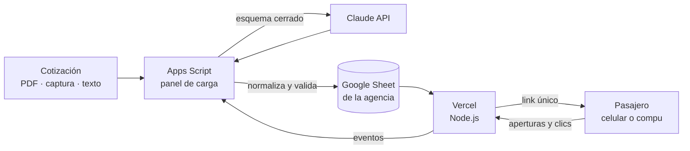

# Propuestas de viaje interactivas con IA

Convierte la cotización de un operador turístico (PDF, captura o texto) en una **propuesta web interactiva** con la marca de la agencia, lista para mandar por WhatsApp. La carga se hace con IA: el modelo extrae vuelos, hoteles, opciones y precios, el código los valida y lo que no figura en la fuente queda vacío para revisión humana.

Está en uso en una agencia de viajes y preparada para atender a varias agencias desde un mismo despliegue.

**Demo:** [cotizaciones-gray.vercel.app/a/demo/p/demo-margarita-7Kq2](https://cotizaciones-gray.vercel.app/a/demo/p/demo-margarita-7Kq2)

---

## El problema

Las agencias reciben cotizaciones de los operadores en PDF o en texto, y se las reenvían así al pasajero:

- no tienen la marca de la agencia;
- cuesta leerlas: escalas, horarios, regímenes y equipaje en códigos;
- la agencia no sabe si el cliente la abrió ni cuándo es buen momento para llamarlo.

## La solución

1. El asesor sube la cotización al Google Sheet de su agencia, desde un panel lateral.
2. La IA extrae los datos y completa las pestañas del Sheet.
3. El sistema genera un link único por cliente: una presentación por pantallas con portada, galería, vuelos, qué incluye, asistencia, hotel u opciones para elegir, precio con seña y saldo, botón de WhatsApp y PDF de 2 hojas.
4. Cada apertura y cada clic quedan registrados en el Sheet, y el estado pasa solo a "En conversación" cuando el pasajero escribe.

## Arquitectura

| Parte | Qué hace |
| --- | --- |
| `apps-script/Codigo.gs` | Menú del Sheet, carga con IA, normalización, biblioteca de fotos, registro de aperturas |
| `apps-script/CargaIA.html` | Panel lateral para subir la cotización |
| `lib/data.js` | Lee el Sheet de cada agencia (con caché por agencia) |
| `lib/render.js` | Arma la propuesta: pantallas, celular, PDF, WhatsApp |
| `lib/agencias.js` | Resuelve la agencia por dominio o por ruta `/a/<clave>` |
| `api/p.js`, `api/evento.js`, `api/fotos.js`, `api/inicio.js` | Página de la propuesta, eventos, búsqueda de fotos e inicio por agencia |

## Cómo se controla a la IA

La regla principal es que **la IA nunca inventa datos**. Para cumplirla no alcanza con pedirlo en el prompt:

- **Salida estructurada:** el modelo responde con una herramienta (`tool use`) y un esquema JSON cerrado. Clases de vuelo, regímenes y planes de asistencia son listas fijas, con la opción "No figura".
- **Normalización en código:** los aeropuertos se reemplazan por los de una tabla fija por código IATA; horarios, fechas y equipaje se validan con formatos estrictos; las coberturas de asistencia salen de la tabla del plan, no del texto del modelo.
- **Revisión humana:** lo que no figura queda vacío y el resumen de la carga lista qué revisar.
- **Modelo según la tarea:** uno más capaz para extraer documentos y uno más rápido y barato para elegir fotos.
- **Fotos con criterio:** primero una biblioteca curada por destino y hotel; la búsqueda en internet es opcional, la IA descarta fotos repetidas, en blanco y negro o de otro lugar, y cada foto guarda su crédito y licencia.

## Varias agencias

Un solo despliegue atiende a varias agencias. Cada una tiene su propio Sheet, su Apps Script, su marca (pestaña `config`: nombre, logo, colores, WhatsApp) y, si quiere, su dominio. Una propuesta solo se abre en el dominio de su agencia, y los eventos van al Script de esa agencia con su propia clave.

## Calidad

- Pruebas automáticas con datos simulados de Sheets y de la API para la carga con IA, el ruteo entre agencias y el registro de eventos.
- Pruebas de interfaz con navegador real: pantallas, celular, opciones sin preselección, fotos que fallan.
- Auditoría del producto con backlog priorizado (P0–P3) y 24 casos de prueba funcionales, de integración, de seguridad y de experiencia.

## Próximos pasos

- Leer el Sheet con una cuenta de servicio, para que no tenga que estar compartido con el enlace.
- Estado "Borrador" antes de publicar lo que carga la IA.
- Copias fijas de cada propuesta enviada e historial de versiones.
- Duplicar propuestas y un panel de edición en una sola pantalla.

## Stack

Claude API · Google Apps Script · Google Sheets · Vercel (Node.js, funciones serverless) · Wikimedia Commons y Pexels para fotos

## Instalación

Ver [docs/INSTALACION.md](docs/INSTALACION.md).
